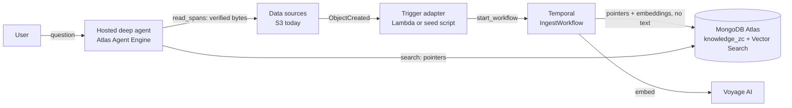
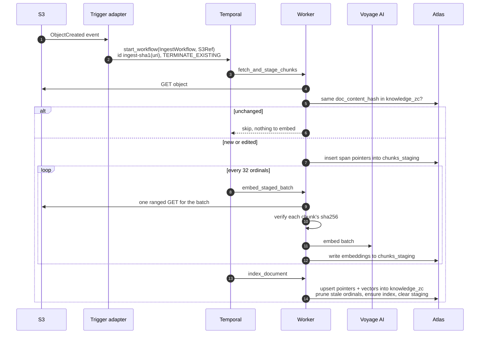
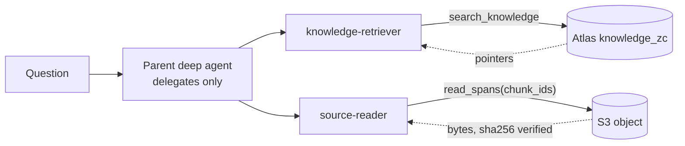

# zero-copy-rag

Zero-copy RAG on MongoDB Atlas. **Temporal** ingests documents from S3 into Atlas Vector Search,
and a deep agent on **Atlas Agent Engine** answers questions from them. The index holds
embeddings and byte-range pointers only. Document text stays in S3 and is read back, checked
against a SHA-256 taken at index time, whenever the agent cites it.

> **Developers:** see [docs/RUNBOOK.md](docs/RUNBOOK.md) for prerequisites, API key setup,
> local spin-up, and cloud infra references.

---

## What is Temporal?

[Temporal](https://temporal.io) is a **durable execution platform**. You write workflows as
plain Python functions, and Temporal records each step, retries the ones that fail and resumes
the rest after a crash or a deploy.

In this architecture Temporal owns ingestion:

| Concern            | What Temporal guarantees                                                                                                                                                                          |
| ------------------ | ------------------------------------------------------------------------------------------------------------------------------------------------------------------------------------------------- |
| Ingestion pipeline | A crash mid-embedding resumes from the last completed batch and never re-embeds what is already done ([durable execution](https://docs.temporal.io/evaluate/major-advantages#fault-oblivious-code)) |

---

## The problem this solves

Most RAG pipelines copy each chunk's text into the vector store next to its embedding. That
second copy of every document sits outside the access controls of the bucket that already holds
it, and it goes stale without anyone noticing when the source changes or is deleted.

This project keeps one copy. Atlas records where each chunk's bytes are, not the bytes. A changed
object reads back as `stale` and a deleted one as `missing`, so the agent never quotes an old
copy. Ingestion stays durable: a crash mid-embedding resumes at the first unfinished batch and
never re-embeds finished chunks.

---

## Architecture

### High-level design

Temporal brings durability to the ingestion pipeline; a separately deployed deep agent queries
what it produces.

**How to read the diagram below:**

1. An object landing in **S3** starts a workflow in Temporal directly. S3 is the only source
   today; other sources would plug in at the same trigger (LLD section 13).
2. **Temporal** chunks the content, calls **Voyage AI** for embeddings, and upserts a pointer
   plus its embedding into **Atlas Vector Search**. The chunk text is never stored.
3. A **hosted deep agent**, deployed separately on **MongoDB Atlas Agent Engine**, answers
   questions over the fresh knowledge: one sub-agent searches for pointers, another resolves a
   pointer back to the source object to read the text behind it.



> **Design note:** the direct trigger (S3 to the ingest workflow, no message broker) relies on
> Temporal's durable execution for the "don't lose the event once the workflow starts" guarantee.
> See [ADR 0002](docs/decisions/0002-split-ingestion-and-query-planes.md).

### Division of responsibility

| Concern                                                       | Owner                     |
| ------------------------------------------------------------- | ------------------------- |
| Orchestration, retries, checkpointing, resumability           | **Temporal**              |
| Vector index, pointers, active-collection pointer             | **MongoDB Atlas**         |
| Embeddings                                                    | **MongoDB Voyage AI**     |
| Agent runtime, sandboxing, egress policy                      | **Atlas Agent Engine**    |
| Model calls (Anthropic by default)                            | **LLM provider**          |

---

## Atlas data model

```text
Database: temporal (MONGODB_DB)
├── chunks_staging       ← intermediate chunks (spans, not text) during IngestWorkflow
├── knowledge_zc         ← embeddings + source pointers, Atlas Vector Search index (active), no text
├── knowledge_v2         ← second collection for a model change (re-ingest, then cutover)
└── temporal_config      ← active collection/index pointer (flipped by cutover)
```

Retrieval reads the same database the pipeline writes, so there is no sync lag between them.
Document text never lands here; it is read from the source object at query time. The pointer
contract and the collection schemas are in [docs/LLD.md](docs/LLD.md) sections 3 and 8.

---

## Ingestion

Ingestion turns objects landing in storage into embedded, searchable knowledge, durably and
**without a message broker**. An S3 **ObjectCreated** event starts a Temporal `IngestWorkflow`
directly: an AWS Lambda in production, through the shared `handle_s3_event`. Locally,
`make seed` uploads the object and starts the same workflow itself. Once `start_workflow`
returns, the change is safe: Temporal runs the workflow to completion across retries and worker
restarts.

- **Trigger goes directly to Temporal.** Temporal's durable execution provides the "don't lose the
  event" guarantee; the trigger is a thin adapter (`pipeline/lambda_handler.py`).
- **Idempotent, update-in-place.** A whole-object hash skips unchanged uploads. An edited object
  re-embeds and upserts in place, and chunks the new version no longer has are pruned.
- **Batched & scale-out.** Chunks embed in batches of 32, one ranged read and one Voyage call per
  batch; documents ingest concurrently, and more worker processes on the same task queue scale
  it horizontally.
- **Output.** Each chunk's embedding and a pointer back into the source object land in
  `knowledge_zc` with an Atlas Vector Search index, never the chunk text. Internals:
  [docs/LLD.md](docs/LLD.md) sections 5 and 6.

### Ingestion sequence diagram

The flow at the level of the activities in `pipeline/activities/ingest.py`:



A document that yields zero chunks (deleted, empty, unsupported or not valid UTF-8) goes to
`clear_document` instead, so it stops being citable. Deleting an object from the bucket fires
the same workflow, which finds the object gone and clears it.

---

## The query plane

The query agent is deployed separately from ingestion: a deep agent on **MongoDB Atlas Agent
Engine** (`mongodb_agent_engine/`), with two sub-agents split by capability:

- **`knowledge-retriever`** searches the vector index and returns pointers (chunk id, source URI,
  span, score), never text.
- **`source-reader`** is the only sub-agent given the tool that resolves pointers against the
  source object and returns the text behind them, hash-verified at read time. It reads at most
  twelve chunks per call, concurrently, and only chunk ids that a search returned.



Both tools run in the Agent Engine Tool Pod, which alone holds the database, Voyage, model and
AWS credentials. Egress is deny-all apart from four named hosts in `agent.yaml`. Document text
lives only in the object store; the searchable collection never stores it. See
[docs/LLD.md](docs/LLD.md) section 11 for the deployed topology and what is and is not
enforced, and [mongodb_agent_engine/README.md](mongodb_agent_engine/README.md) for the SDK and
deployment details. Atlas Agent Engine is in Public Preview, which MongoDB does not recommend for
production workloads.

---

## Quickstart (local demo)

**Prerequisites:** `uv`, the Temporal CLI, an S3 bucket the agent's egress allow-list names
(`temporal-agentic` in `us-east-1` as shipped), and, for the Playground, Docker and the
`agentengine` CLI. See [docs/RUNBOOK.md → Prerequisites](docs/RUNBOOK.md#prerequisites) for install commands.

```bash
# 1. Clone and enter the repo
git clone https://github.com/mohammaddaoudfarooqi/zero-copy-rag.git
cd zero-copy-rag

# 2. Copy and fill in credentials
cp .env.example .env
# Edit .env: set MONGODB_URI, VOYAGE_API_KEY, S3_BUCKET, the AWS keys, LLM_API_KEY

# 3. Install Python dependencies
make setup

# 4. Start the Temporal dev server and the worker
make start

# 5. Create the Atlas Vector Search index (one-time)
make index

# 6. Upload a sample document to S3 and start its ingest
make seed

# 7. Start the Agent Engine local stack and ask questions in the Playground
make playground

# 8. Tear everything down
make stop
```

Steps 4 to 7 are also `make demo`. Everything runs locally except the object store and Atlas:
the worker and the Playground's tools read the same bucket and collection, so a document
seeded in step 6 is citable in step 7. The same agent deploys to Atlas Agent Engine with the
`agentengine` CLI, and the hosted deployment has its own Playground; see
[docs/RUNBOOK.md section 10](docs/RUNBOOK.md#10-query-plane-hosted-deep-agent) and
[mongodb_agent_engine/README.md](mongodb_agent_engine/README.md). `make help` lists all
targets.

| Service         | URL                   | Notes                                              |
| --------------- | --------------------- | -------------------------------------------------- |
| Temporal Web UI | http://localhost:8233 | watch `IngestWorkflow` runs                        |
| Playground      | http://localhost:3000 | `make playground`; `dev up` prints another port if 3000 is taken |

---

## Repo layout

```text
zero-copy-rag/
├── README.md
├── LICENSE                         ← Apache-2.0 (not covering seed/)
├── Makefile                        ← all dev commands (make help)
├── pyproject.toml                  ← Python deps managed by uv
├── uv.toml                         ← uv resolver settings
├── .env.example                    ← copy → .env, fill credentials
├── agent.yaml                      ← Agent Engine manifest: entrypoint, secret grants, egress allow-list
├── dev.yaml                        ← local `agentengine dev up` settings only
├── .agentengineignore              ← narrows what `agentengine build` uploads
├── seed/                           ← sample Markdown documents for `make seed`
├── evals/                          ← retrieval eval cases for the seed document
├── tests/                          ← pytest suite (docs/RUNBOOK.md section 4)
├── mongodb_agent_engine/
│   ├── app.py                      ← hosted deep agent: search + read tools, two sub-agents
│   ├── llm.py                      ← model selection (LLM_PROVIDER, LLM_MODEL)
│   └── README.md                   ← SDK surface, capability boundary, deployment notes
├── pipeline/
│   ├── worker.py                   ← Temporal worker process (ingestion only)
│   ├── trigger.py                  ← shared handle_s3_event → start IngestWorkflow
│   ├── lambda_handler.py           ← AWS Lambda entrypoint for real S3 (same handler)
│   ├── retrieval.py                ← vector search, returns pointers, never text
│   ├── spanio.py                   ← resolves a pointer against the source object, hash-verified
│   ├── workflows/
│   │   ├── ingest_workflow.py      ← IngestWorkflow: stage → embed in batches → index
│   │   └── reconcile_workflow.py   ← ReconcileWorkflow: catch what events missed
│   ├── activities/
│   │   ├── ingest.py               ← stage + embed + index + clear activities
│   │   └── reconcile.py            ← plan a sweep: bucket listing against indexed ETags
│   ├── extractors/                 ← Markdown extractor (byte spans); other formats are refused
│   ├── config_store.py             ← active collection/index pointer
│   └── search_index.py             ← idempotent Atlas Vector Search management
├── infra/
│   ├── create_atlas_index.py       ← `make index`
│   ├── query_atlas.py              ← `make query`
│   ├── eval_retrieval.py           ← `make eval`: recall of expected phrases in the top-k chunks
│   └── atlas_indexes.json          ← Vector Search index definitions
└── docs/
    ├── RUNBOOK.md                  ← developer setup guide
    ├── LLD.md                      ← low-level design
    └── decisions/                  ← Architecture Decision Records
```

---

## Developer guide

| Document                                               | Description                                                                                       |
| ------------------------------------------------------ | ------------------------------------------------------------------------------------------------- |
| **[docs/RUNBOOK.md](docs/RUNBOOK.md)**                 | Prerequisites, API key setup, local spin-up, cloud infra references                               |
| **[docs/LLD.md](docs/LLD.md)**                         | Low-level design: data contracts, workflow internals, scaling to multiple sources and data types  |
| **[mongodb_agent_engine/README.md](mongodb_agent_engine/README.md)** | The hosted deep agent: SDK surface, what the capability split enforces, deployment on Atlas Agent Engine |
| **[docs/decisions/](docs/decisions/)**                 | Architecture Decision Records: pointers instead of text (0001), ingestion and query planes (0002) |

---

## License

The code is licensed under the [Apache License 2.0](LICENSE). The sample document in `seed/`
is not covered by that license and keeps its own copyright notice.
